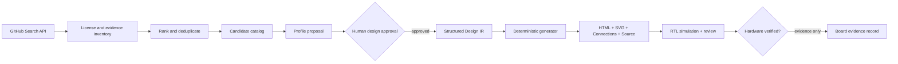

# Architecture — FPGA SoC Capstone Harness

## System of record
1. **Reference record** (`catalog/discovered.json`): URL, license, snapshot tree SHA, file evidence, detection category, timestamp. Untrusted metadata.
2. **Proposal** (`catalog/proposals.json`): automatically suggested capstone profile with `pending_review` state. Never a functional or board-tested RTL claim.
3. **Design IR** (`capstones/*/design.json`): reviewed modules, explicit ports, net endpoints, board/safety constraints, source file list and expected checks; canonical source for diagram and HTML.
4. **Generated artifacts** (`site/`): navigation HTML, capstone HTML, SVG topology, machine-readable connections JSON, copy of first-party source, verification status.

## Transformation stages

Automatic discovery does not imply authorization to copy a repository. No remote build scripts are run. The generator copies **only local files enumerated by a locally maintained Design IR**. For third-party material, retain attribution, SPDX license, source URL, exact version and transformation diff separately after a manual review.

## Source transformation policy
- **Collect**: GitHub metadata and a bounded tree-file inventory; no source payload.
- **Classify**: application (motor, sensor, video, instrumentation, security, communication) and board vendor, with heuristics explicitly marked.
- **Propose**: map an application to existing, original RTL building blocks. This is a *draft architecture*, not a port.
- **Implement**: reusable first-party RTL in isolated controller modules; top remains board shell/wrapper; AXI connectivity declared separately.
- **Verify**: simulate RTL, inspect synthesized interfaces, constrain clocks and IO, verify voltages and board connections, then test actual board.
- **Publish**: source lineages, board compatibility, limitations and independent verification evidence.

## Technology placement
- Basys3 + MicroBlaze V: primary target, AXI GPIO first, AXI4-Lite custom IP after isolated verification.
- AMD/Xilinx: Vivado/Vitis project and XDC.
- Intel/Altera: Quartus + Platform Designer, Avalon/QSF.
- Lattice: Radiant/Propel or Yosys nextpnr, LPF/PCF.
- Vendor-specific paths are independent adapters; generic RTL is not claimed plug-and-play across vendors.

## Design IR rules
- Module IDs/ports in `connections` must exist in the design's `modules`.
- The diagram is generated from those IDs and links, never from a free-form AI-drawn schematic.
- Pin map is not generated from guesses. Physical pin assignments must be matched to official board master constraints and test hardware.
- `verification.json` records separately static validation, RTL simulation, synthesis, timing, implementation, board test and evidence.
- No resources, WNS, Fmax or power numbers are fabricated.

## Further development
- Provider adapters (AMD/Intel/Lattice), register-map schema, module interface registry, license/SPDX audit, auto-generated Cocotb/UVM tests, KiCad connectivity IR, ERC/DRC, CI artifact provenance, optional Elasticsearch search index.
- Changes to source code or vendor pin constraints should be proposed via reviewable PRs, not scheduled direct overwrites.
